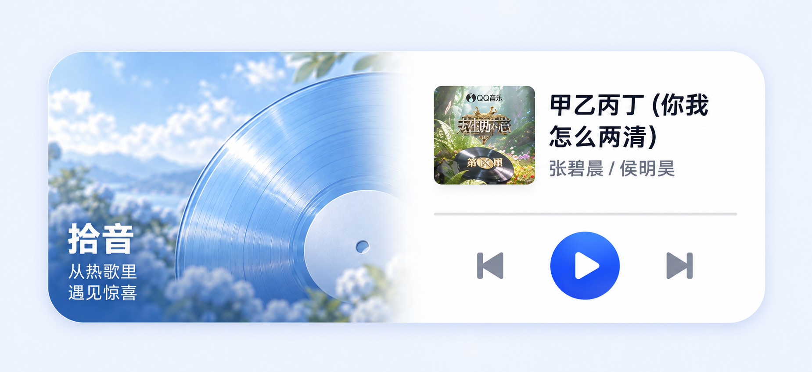
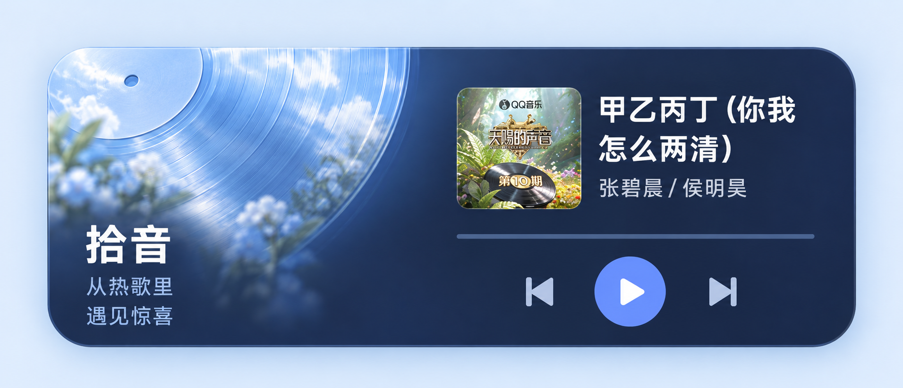

# #131 已确认的小部件设计

用户确认同时实现云光浅色与沉浸深蓝两稿，由用户在桌面小部件列表中选择。两稿均为一个完整外框，左侧拾音、右侧播放器。保留原 Provider 作为浅色入口，新增独立深蓝入口；两个外观可并存，共用同一实际播放队列。

以下为用户确认的设计参考稿，非运行时截图；歌曲信息、真实封面和控制由原生动态绘制。





## 原生结构

- 单一圆角容器：28dp 外圆角、连续背景，没有中间壁纸间隙或独立的右侧卡片。
- 左侧原生标题 24sp、副标题 13sp；右侧封面 48dp、两行歌名 14sp、单行歌手 12sp。
- 右侧 42dp 播放圆形填充，三个控制点击区均至少 48dp。
- 默认约 4×2；展开断点为 320dp 宽、144dp 高，高度随系统字体比例增加。右侧两边各留白 8dp，因此最窄展开宽度下仍有 144dp 放置三个 48dp 控制。较小空间使用同样配色的紧凑播放器，实际桌面格数由启动器决定。
- 中文文案、专辑封面、播放状态和按钮均在运行时绘制或更新，生成图片只承担背景插画。

## 背景素材

使用内置 Image Gen，以用户上传的两张已确认设计为编辑目标，移除所有 UI 前景并提取背景；没有改动播放器逻辑或把整张设计稿作为静态小部件。

- 浅色：`src/assets/imgs/widget-cloud-light-v1.png`
- 深蓝：`src/assets/imgs/widget-cloud-dark-v1.png`

原生背景解码后将右侧正文区合成为集中语义表面；左侧正文区遍历实际像素，计算达到 4.5:1 对比度所需的最小压暗强度，并在正文范围外平滑淡出。正文不依赖生成图片对颜色的近似描述。预设与自定义主色的按钮对比度由 `resolveWidgetAppearance` 派生。

## 最终生成提示

浅色素材，输入为用户确认的浅色稿：

```text
Use case: precise-object-edit. This is a production background-asset extraction from an APPROVED Audiora music widget design, not another UI concept. Extract ONLY the widget's background from the supplied image. Preserve its beautiful translucent pale blue vinyl, sky, flowers, foliage, and original overall composition and its smooth fade to pure white on the right. REMOVE ALL UI foreground: the Chinese 拾音 title, both subtitle lines, the square album cover, the song title and artist, horizontal line, previous/play/next controls, and all icons/logos/letters. Fill removed regions naturally with the same background photo or white surface. Crop away ALL external pale-blue page background, white space outside the widget, border, outline and drop shadow. Output a FLAT EDGE-TO-EDGE RECTANGULAR background asset, no rounded corners, no transparency, no outer padding; native Android will clip its corners. Target exactly 1600×736 pixels, aspect ratio 400:184. Left 48% is the existing photo, right 48% is completely solid exact white #FFFFFF, smooth blending near the middle, preserve the original composition. In the lower-left area from x=0 to x=560 and y=350 to bottom, retain a soft deep blue photo scrim suitable for overlaying small WHITE native text with at least 4.5:1 contrast; preserve a natural photographic appearance and no distinct rectangular box or seam. Blue vinyl should remain visible to the right of the lower-left text-safe area. No text, no typography, no symbols, no music album cover, no controls, no UI lines. This image is ONLY the background layer, not a screenshot.
```

深蓝素材，输入为用户确认的深蓝稿：

```text
Use case: precise-object-edit. This is production background extraction from the supplied APPROVED Audiora navy music widget, NOT a new UI design. Output ONLY the background layer. Preserve the exact approved composition: giant luminous ice-blue translucent vinyl occupying upper-left, subtle pale flowers and blue sky, dissolving into a continuous deep navy surface in the lower left and throughout the right half. REMOVE ALL UI foreground entirely: the Chinese 拾音 label and subtitle, square album cover, music title, artist, divider and previous/play/next controls, all logos or letters. Replace removed objects with matching navy/photo so nothing remains recognizable as a UI element. Crop away ALL exterior pale blue canvas, outer margin, outer frame, border and drop shadow. Output one FLAT EDGE-TO-EDGE rectangle, no rounded corners, no transparency, no padding. Native code will clip the actual widget outline. Intended target 1600×736 pixels (400:184 aspect ratio). The rightmost 48% of the image must be perfectly flat exact Audiora navy #18233C, not a gradient, for matching native UI foreground colors; smoothly blend the illustration into it near the center. Lower-left native-text-safe region x=0..560 and y=350..bottom must blend to dark navy #18233C, with bright vinyl remaining only above and to the right of that text-safe region. Keep its atmospheric blue photo character and smooth integrated blending. No captions, no watermark, no text, no icon, no controls, no lines or album thumbnail; background artwork only.
```

## 验收边界

按仓库的预览交付要求，构建并安装后仅核对版本；不自动启动 App、截图或替代用户完成原生视觉验收。`audiora-test 0.3.1-preview.widget131.v4` 已安装并核对版本，用户于 2026-10-19 手动验收后反馈「没问题了」。自动化检查不能代替真机验收。

用户后续确认了固定的点击语义：左侧直接拾音，右侧按钮控制播放，封面和歌曲信息打开 App。冷启动通过播放服务和 Headless JS 恢复，不再先展示首页；两种已确认外观均沿用这一行为。新增验收重点为进程回收后点击拾音、后台拾音后再打开 App 时队列保持，以及无可用音源、网络失败与重复点击时的反馈。
