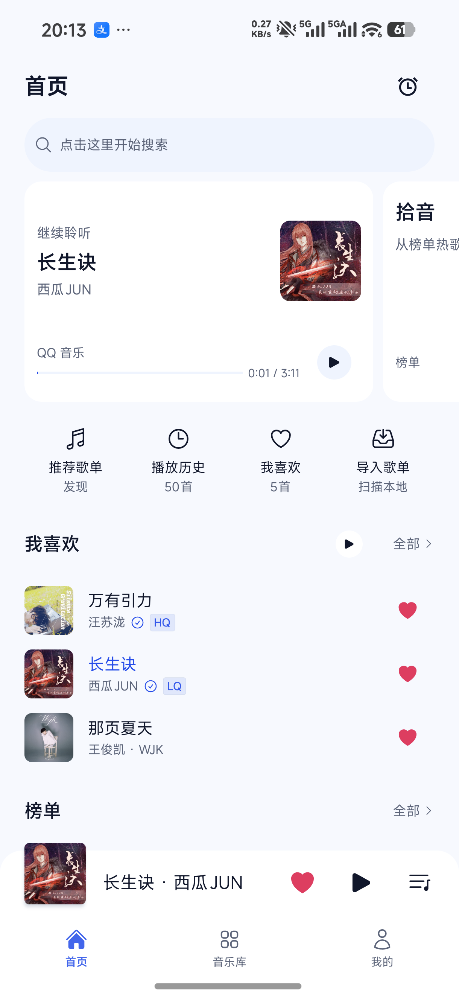
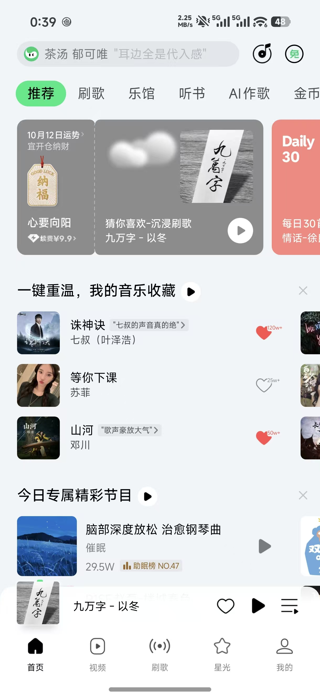

# 首页比例与内容优先级修正 · 2026-10-12

## 依据

用户明确要求截取当前手机页面；截屏完成后，用户把该首页与外部首页一起提供用于对比，并确认执行修正。

- 当前首页：20:13 的 homeui.20261012.195427 版本。以下图片是修改前证据，不是本次修正后的截图。
- 外部参考：8c13832cb8eaa760ffc286a09ed0a81c.jpg。以其紧凑搜索、横向主卡和收藏歌曲组为结构参考，继续遵循 Audiora 的音乐库/我的主题与公共组件。

## 发现与处理

| 问题 | 原因 | 修正 |
| --- | --- | --- |
| 页面名称与搜索占两行，搜索形状显得过厚 | 把管理页面页头直接用于首页；将最小点击高度直接用于可见背景 | 搜索与定时同一行，搜索可见背景 60rpx；外层点击范围继续至少 44dp，长提示自然适配 |
| 主卡空白多，封面偏小 | 最低 180dp 与比例尺寸混用，main flex:1 撑大空白 | 使用 300rpx 最低高度并允许内容自然增长，main 不吸收多余高度；封面 132→164rpx，卡片圆角回到普通内容卡 |
| 主卡与下一张卡难区分，下一张只露文字碎片 | 两张白卡，下一卡关键图标在右側 | 主卡使用既有 cardInset/onCardInset 语义；拾音保留白底，将 shuffle 图标置于左上，横滑露出部分即可识别 |
| 首屏有重复播放进度和大量管理入口，音乐展示靠后 | 当前歌曲在主卡、收藏和常驻播放条重复；四快捷入口先于歌曲 | 主卡保留真实歌名、作者、来源和继续/暂停，进度留给现有播放器；快捷入口移到榜单之后，折为紧凑图标＋文字行 |
| 收藏是音乐库式纵向小封面列表 | 公共 MusicItem 默认带入技术元数据及较小封面 | 复用 MusicItem 的播放、收藏持久化、防连点、失败恢复和当前项逻辑；新增 opt-in discovery 展示，封面 100rpx、作者 22rpx，隐藏额外专辑/本地勾选/音质/VIP/MV 徽标。默认 library 展示不变 |
| 收藏播放离标题较远，缺少横向发现 | 管理型标题和右侧聚合动作 | 标题为“重温我的收藏”，播放紧邻标题，全部仍在右；每列三首，最多展示九首真实收藏，约 86% 屏宽露出下一组。单首和播放全部仍使用完整歌单队列 |

## 范围与保留行为

保留搜索、定时、已有拾音算法与加载状态、推荐歌单、播放历史、收藏与导入、完整榜单、最近播放及底部播放器/三个主导航。收藏预览上限只影响首页渲染，完整播放队列不截断，全部进入既有默认收藏详情。零收藏时没有假歌曲或可用播放全部，沿用说明和搜索入口。

新增标题的简体、繁体、英文与类型声明。没有新增依赖、字体、生成图片、原始颜色或持久化配置；未复制会员、运势、热度、频道及不存在的推荐数据。

## 验证

- 11 个相关 Jest 套件，104 项回归通过（首次新增测试断言修正后，失败套件单独重跑通过）；涵盖下一组收藏的真实播放、超出预览的完整队列、空收藏、默认歌曲行恢复、音质/VIP/MV 隐藏及收藏操作。
- 17 个颜色套件，180 项通过；听歌卡验证浅色、深色、自定义主色、透明表面，文字在实际 cardInset 上至少 4.5:1，独立播放图形在实际按钮底上至少 3:1。
- check:colors、check:ui、typecheck:runtime、改动文件 ESLint、git diff --check 通过。没有增加基线或豁免。
- npm run lint 执行后仍有 14 个既有错误和 100 个警告。无关的 service/index.ts 与 lrcParser.ts 自动格式调整已检查并恢复。显式 TypeScript 有仓库既有诊断，此次改动文件没有诊断。

## 原生验收边界

此次依据已有截图修正。安装新预览并确认版本后，按 AGENTS.md 停止设备操作；不自动打开、点击或再截屏。新版本在真实屏幕上的比例、横滑、长标题、各主题及实际音频仍由用户验收，组件测试与构建不能代替视觉通过。

## Android 预览交付

- 应用源提交：49a891018bf8c6e37f7c46a25c33a68d2a19d819；短路径独立工作树 D:/a105。构建使用 scripts/build-preview.ps1，并在构建前复制三个字体。
- 包名 io.github.yingjiedev.audiora，versionName 0.3.1-preview.i88.homerefine.20261012.203736，versionCode 1791808656，ABI arm64-v8a。
- APK：D:/audiora-previews/issue-88/Audiora-v0.3.1-preview.i88.homerefine.20261012.203736-arm64-v8a-release.apk。SHA-256：57F6A20DFFCE2393E0326B6EA8C5302E8514A1B30E40F6F263F6D132F47D2E67。
- 校验实际 APK 的精确元数据、干净源提交、v2 单签名者、字体字节/哈希与黑胶资源；签名证书与当前安装包比对一致。
- adb install -r 保留数据升级已配对真机，从 homeui.20261012.195427 / 1791806067 升级成功。实际安装的完整版本名及 versionCode 1791808656 确认后，停止所有设备操作。
- 验证 JSON：D:/audiora-previews/issue-88/Audiora-v0.3.1-preview.i88.homerefine.20261012.203736-verification.json。新包没有自动启动、点击、截屏或模拟器验收；原生外观及实际音频仍待用户验收。
