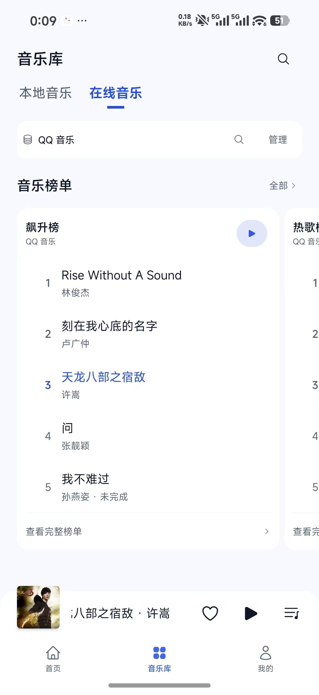
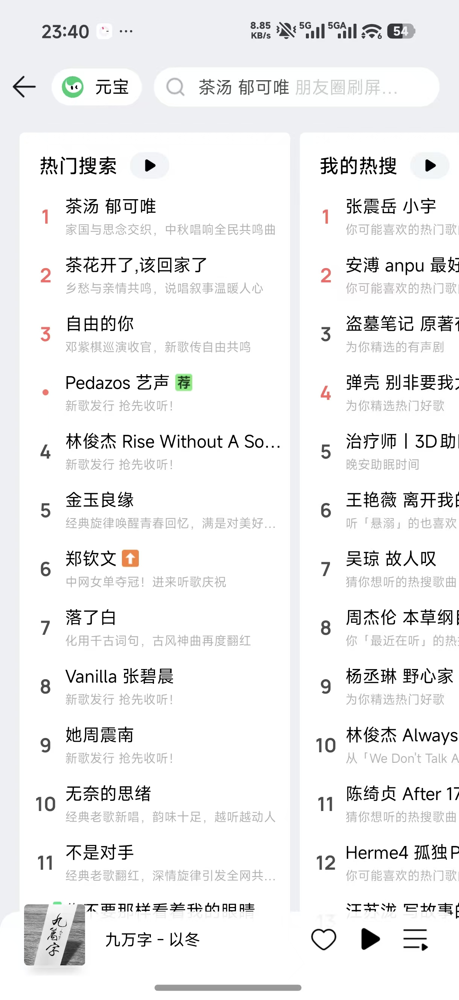

# 在线榜单视觉复审

2026-10-12。范围是用户本次提供的在线音乐页与排行参考图。此文件先记录用户确认的审查结论，后附授权后的修正与交付记录。

## 图像与证据边界

1. 当前在线音乐页：功能内容已出现，视觉比例未达到预期。
   
2. 用户指定的参考：横向排行卡的宽度、密度与层级是此次对照目标。
   

截图都来自用户。宽度、位置和间距按同为 941px 宽的展示图近似测量，不能当作原生 dp。参考属于搜索页，当前属于带页标题和主标签的音乐库；因此不直接要求两页的顶部高度完全相等。此审查没有检验滑动、声音输出、辅助技术阅读顺序或其他主题的原生表现。

## 结论

上一版的卡宽、歌曲行距和标题层级取值有误，使横向排行成为一张近乎满屏、只有五首内容的大卡片。顶部独立来源栏和分区标题继续叠加留白，卡内又有多余左缩进和重复来源说明。问题首先是结构与比例，其次才是圆角和按钮颜色。

## 逐项对照

| 项目 | 参考图 | 当前实现及后果 | 建议 |
| --- | --- | --- | --- |
| 横向卡宽 | 单卡约占屏宽 59%，第二张有较完整的标题和内容列 | 单卡约占 82%，第二张只露出约 11% 屏宽，几乎只有序号；不利于判断下一张是什么 | 多卡场景以屏宽 60–64% 为起点，让下一张至少露出标题及部分歌曲；单卡保持适当可用宽度，不强行留下空白 |
| 歌曲密度 | 同屏可见 10 首以上，行距约 120px | 歌曲行约 150px，五首撑出约 1000px 高的卡；卡片面积与信息数量失衡 | 公共歌曲行增加榜单紧凑模式，行高从 120rpx 调整到约 92–100rpx；外层与内部主点击区同时调整，保留至少 44dp 点击范围 |
| 卡内左轴线 | 标题靠内边距，序号与标题大致同轴，歌曲名称紧跟序号 | 卡标题从 x≈78 开始，歌曲名称从 x≈181 开始，缩进超过 100px，左半区域显得空 | 清理歌曲行既有左右 padding；序号列 28–32rpx，列间距 8–12rpx；从卡片内边距建立唯一的序号与内容轴线 |
| 标题层级 | 榜单标题比单条内容更醒目，容易扫视多个榜单 | 卡标题用 26rpx，歌名用 28rpx；卡名称甚至比歌曲文字小 | 榜单标题用 30–32rpx/600，歌名用 26–28rpx/400，作者用 20–22rpx；保留独立字号层级 |
| 顶部结构 | 短操作栏之后直接进入排行 | 页标题、主标签、来源白卡、音乐榜单标题、榜单卡分五层；来源栏底到卡顶还有约 145px，阅读重点被推迟 | 保留音乐库页标题和主标签；来源改成轻量同行切换与管理，收紧来源到分区、分区到卡片的间距；避免再造大摘要卡 |
| 来源说明 | 每卡主要呈现榜单名称与内容 | 顶部已显示 QQ 音乐，每卡标题下又重复 QQ 音乐，增加一行结构 | 同一来源的榜单组只在组头显示来源；混合来源时才需要卡内来源标注 |
| 播放按钮 | 小型中性浅底，视觉上贴近榜名 | 浅蓝底蓝色三角，尺寸和颜色比卡标题更醒目，且远置于右侧 | 缩小可见底形，采用中性表面和普通前景；保持外层 44dp 点击范围，按钮靠近榜名或沿卡头稳定对齐 |
| 排名表达 | 数字靠近内容，前三有明显的字重与色彩差异 | 普通序号均为灰色，第三项因正在播放变蓝；此前设计主要靠细微字重表达前三 | 前三用更明确的字重区分，当前播放继续独占 active 语义；不借用 danger/favorite 表示热门，不凭空制造上升、新歌标签 |
| 卡片与底部 | 容器简单，列表延续性强 | 圆角较大、五首之后立刻出现高占位完整榜单入口，卡片像大型操作面板 | 榜单卡使用较小的现有圆角令牌，完整入口用紧凑底行；优先展示约 10 首真实歌曲，不足时展示实际数量 |

## 源码确认的原因

- `OnlineMusicLibrary` 的 `cardWidth = contentWidth * 0.92` 是“可用内容区域的 92%”，折算到截图约为屏宽 82%，并非参考图约 59% 的卡宽。
- `useLibraryCharts` 将预览明确截为五首。五首是上次的主动设计限制，不是截图中的来源数据不足证据；改变展示数量需同步队列名称与测试，播放文案必须与真实加载数量一致。
- `MusicItem` 外层及内部 `main` 都有 120rpx 最小高度，`main` 另有 20rpx 上下 padding；仅改外层高度无法形成紧凑行。
- 当前 `containerStyle` 只提供 `paddingHorizontal: 0`，公共行仍有方向专属的 `paddingLeft: spacing.xxl` 与 `paddingRight: spacing.xs`。需要显式覆盖左右方向值，而不是依赖横向缩写消除原有缩进。
- 卡标题是 `subTitle`（26rpx），歌曲标题默认 `content`（28rpx），标题弱于内容是代码中的真实层级倒置。
- 当前颜色和行为回归测试验证的是已声明规则，不评价卡宽、视觉密度及层级是否美观。此前测试通过不代表视觉目标达到。

## 执行顺序与验收目标

1. 先改卡宽与紧凑行：目标是看见下一张榜单的名称及至少部分歌曲文字；每张约十首真实歌曲，不靠拉高五首的留白撑满容器。
2. 修正内边距、序号列和标题字号：序号轴线贴近卡头，歌名获得可用宽度，作者紧跟标题；英文长歌名按一行省略处理。
3. 合并重复来源说明并收紧顶部：页面功能入口保留，但正文更早进入阅读视野。
4. 最后微调按钮与圆角：延续“我的/设置”的页底、白卡、文字及语义色，参考图的红绿和低对比度灰字不作为新色板。

复用公共歌曲信息、选中状态与播放行为，为 `MusicItem` 提供场景密度选项；避免复制一套独立歌曲组件，也避免全局收紧搜索/收藏/本地行。单卡、多卡、不足十首、失败和长标题需分别检查。真实列表点击范围和动态字体表现不能从这两张截图宣称验收通过。

## 已执行的修正

- 多榜单时单卡宽度改为屏宽的 62%，在普通手机宽度下下一张约露出半张；仅一个榜单时使用可用内容宽度，宽屏上继续限制最大 480dp。
- 公共 `MusicItem` 新增可选 `density="compact"`：外层和内部点击区一起调整为至少 44dp / 96rpx，标题 26rpx、元信息 20rpx；显式清除左右内边距，收紧标题与说明间距。其他场景沿用默认模式。
- 预览最多十首真实歌曲，保持歌曲身份去重与原始对象；不足十首时展示实际数量，播放名称和队列同步使用实际数量。
- 排名列从 40rpx 缩至 32rpx，列间距从 12rpx 缩至 8rpx；前三使用 700 字重，当前播放仍使用 active。榜单标题改为 32rpx/600，字号高于歌名。
- 来源、范围搜索、管理、全部榜单入口合为同一行；移除独立来源白卡与额外分区标题行，卡片内不重复来源名称。来源选择、管理和完整目录功能保留。
- 播放底形改为 64×40rpx 的中性表面，前景使用主题正文色，外层仍至少 44dp；榜单圆角从 28rpx 收至 16rpx，完整榜单底行取消额外上下 padding、说明缩至 18rpx。

## 本轮验证

- 相关回归 11 套件 / 78 项通过，包括紧凑行与默认行、十首真实队列、短榜单实际数量、来源切换、目录/详情重试、迟到响应隔离和榜单播放历史。
- 颜色回归 16 套件 / 171 项通过；中性播放按钮在浅色、深色及代表性自定义/透明表面上验证实际合成对比度。颜色基线和豁免未放宽。
- check:colors、check:ui、typecheck:runtime 通过；修改文件 ESLint 零错误/警告，显式 TypeScript 检查没有修改文件诊断。
- 全仓库 lint 仍有 14 个既有错误、100 个警告，显式 TypeScript 检查仍有仓库既有诊断；无关自动格式化恢复，不把它们记为全仓库通过。
- 此处记录的是源代码与自动回归结果。新版原生截图、真实来源/音频和其他主题的真机外观待用户验收；APK 构建和安装详情随完成后记录在根目录 design-qa.md。
