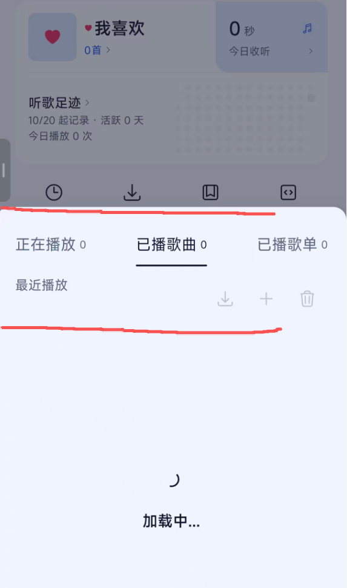

# 播放历史面板进入动画验证

2026-10-20，用户反馈从“我的 → 播放历史”打开面板时，上沿及标题区域短暂掉帧、出现残影。空历史、仍显示加载提示时也可观察到该现象。

此图用于定位问题区域；单张截图不能证明真实掉帧、像素残留或修复后的帧率。

## 最终实现

- 从 Modal 的 `onShow` 开始展开，进入动画完成后再挂载列表；忽略关闭中或卸载后的迟到回调。
- 显式启用 Android Modal 硬件加速，进入动画使用现有 `standard` 曲线、保持 240ms；移除面板容器的 `elevation: 16`，保留圆角裁剪。
- 播放状态由列表统一订阅，缓存歌曲行、拖拽手势及操作回调，减少重复初始化。

## 实机反馈

| 预览版本后缀 | 与上一版相比的改动 | 用户反馈 |
| --- | --- | --- |
| `history-hw.20261020.224333` | 开启 Modal 硬件加速 | 改善 |
| `history-curve.20261020.225029` | 进入曲线从 `decelerate` 改为 `standard` | 无变化 |
| `history-shadow.20261020.230549` | 移除面板容器阴影 | “可以就这样吧”，接受当前版本并要求创建 PR |

最终预览基于 `c7b878e0b027cb07fb7ecd9fb719bcfa230af9b8` 加本次应用代码改动构建，版本为 `0.3.3-preview.history-shadow.20261020.230549`，versionCode 为 `1792508749`，ABI 为 `arm64-v8a`。APK SHA-256：`FB0E38657FBEF32E422C5811E64704F7D2E8FF846DAAE1946FFDC0C97AD560E1`。

APK 元数据、单签名者的 v2 签名及三份字体（未压缩共 23,675,684 字节）已校验；独立预览应用覆盖安装成功，安装版本已核对，随后停止设备操作。用户手动验证，没有由代理启动应用、截屏或执行替代视觉验收。未采集真机帧耗时，不宣称残影完全消除；iOS 尚未实机验证。

预览验证时，8 套面板测试共 34 项通过，修改文件 ESLint、运行时引用及动画回调检查通过；全仓 lint 有 14 个与本次改动无关的既有错误。PR 同步最新主线后的检查结果见 PR 描述。
