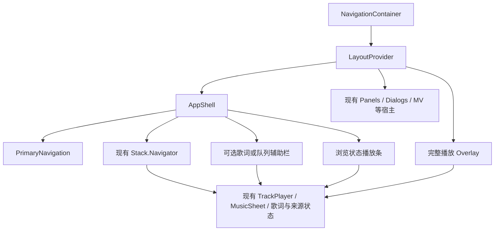

# Audiora 平板适配调研与实施建议

调研日期：2026-10-25。调研源码基准：`c7b878e0`。以下保留前期研究与建议；后续基于 0.3.4 的实施结果及待验收范围见 [平板适配验收记录](../../release/tablet-ui-acceptance.md)。

建议把平板适配分成两次交付：先稳定尺寸、消除裁切，解决 MusicFree #317 的直接痛点；再加入统一的大屏导航、跨页面播放控制和可收起的歌词／队列辅助栏，完成 Audiora #144。两次交付共用一套窗口和容器布局基础，避免产生独立的“平板版页面”。

## 证据范围

- 已读取两个 issue 正文和评论接口。#317 的元数据显示 1 条评论，但本次评论接口返回空数组，网页也未提供可读评论，不能推断其中有额外要求；#144 没有评论。
- 已下载并实际查看 #317 的两张原始截图、Spotify 2026-04-16 官方平板宣传图、Apple Music iPadOS 26 官方说明图，以及 Google 2023-05-10 的 YouTube Music 平板示例。
- 图片存于本次工作区外的 `D:/Users/yingj/.codex/visualizations/2026/10/25/01a1727c-e77b-75e0-ae24-ec1dd1e9ba8f/tablet-research/`。下文提供公开来源，文档不依赖这个本机路径。
- 当前 Audiora 的判断来自源码，不把仓库中的历史手机截图当成当前平板界面。没有启动模拟器、操作设备、采集真机截图或执行原生视觉验收。
- 这是需求研究、公开设计资料分析与源码评估；没有访问并操作竞品的完整应用流程，不称为实际体验审计。竞品示例的年份分别标明，不把历史设计说成 2026 年所有客户端的最新外观。
- 文中的宽度、间距、行高是待验证的设计起点，单位使用 React Native 布局单位；Android 上对应 dp，不能拿截图的物理像素直接替代。

## 两个 issue 应当如何转成验收目标

| 来源 | 明确提出的内容 | 对 Audiora 的含义 |
| --- | --- | --- |
| [MusicFree #317](https://github.com/maotoumao/MusicFree/issues/317)，2024-09-30 | Android 平板 UI 过大；提供 MusicFree 与椒盐音乐截图；希望尺寸适配 | 优先修正控件尺寸和信息密度。用户提到“设备识别”是其设想的实现方式，不必把它变成技术约束 |
| [Audiora #144](https://github.com/yingjiedev/audiora/issues/144)，2026-10-25 | “平板适配”，尚无页面、设备或交互细节 | 可以包含重新组织大屏布局，但侧栏、双栏和窗口行为属于本调研建议，不是 issue 已确认的细则 |

建议将 #144 的完成定义补充为：

1. 同一字号层级、图标和常用行高在手机与平板上保持接近的阅读和触摸尺度。
2. 更多空间用于多展示内容、保留浏览上下文，避免长列表横向拉满、摘要无限变大。
3. 全屏、分屏、横竖屏、连续拖动窗口均能重排；不因跨断点丢失当前歌曲、队列、搜索结果或浏览位置。
4. 平板可边浏览边操作播放、查看歌词或整理队列；手机继续保留现有主要交互。
5. 保留 Audiora 的主题、自定义背景、唱片／窗景卡片、插件来源语义及现有播放行为。

## 当前代码中可以保留的基础

项目已经具备部分大屏能力，适合增量演进：

- [rpx.ts](../../src/utils/rpx.ts) 的 `fontRpx()` 已把字体缩放基准封顶到 430；[uiConst.ts](../../src/constants/uiConst.ts) 中公共字号和常用图标已使用它。
- [musicDetail/index.tsx](../../src/pages/musicDetail/index.tsx) 已有横屏左封面／控制、右歌词的 44%／56% 布局；播放器是根层 Overlay，没有和详情页路由耦合。
- [topList/components/boardPanel.tsx](../../src/pages/topList/components/boardPanel.tsx) 已优先使用 `onLayout` 测得的容器宽度；“我的”页近期内容也有容器测量。这两处可作为其他页面迁移范式。
- 首页主卡、榜单卡和部分封面已有最大宽度；不需要把这些组件全部重做。
- 公共歌曲行、FlashList、TrackPlayer、队列与播放历史数据、歌词状态、`useColors()` 和 motion tokens 可以继续复用。
- iOS `Info.plist` 已声明 iPad 的四个方向且 `UIRequiresFullScreen=false`；Android 主 Activity 声明处理尺寸、方向变化，未在此处锁定方向。这只是配置基础，不能据此判定多窗口已经验收。

## 源码确认的主要缺口

| 位置 | 事实 | 对平板设计的影响 |
| --- | --- | --- |
| `src/utils/rpx.ts:18` | 普通 `rpx()` 按窗口短边缩放，没有几何尺寸上限 | 行高、图标、间距、圆角会继续变大，而公共字体已停止同比增长 |
| `src/constants/designSystem.ts:4` | spacing、radius、controlSize 在模块加载时调用 `rpx()` | 后续分屏／窗口变化不会自动重新生成这些常量；首屏尺寸可能影响后续结果 |
| `src/components/mediaItem/musicItem.tsx:25` | 普通歌曲行最小高度基准为 `rpx(120)` | 大屏上的内容密度低；具体行高还受内容、padding、变体影响 |
| `src/components/musicBar/compactLayout.ts:3`、`HomeBottomNavigation.tsx:119` | compact player 和底部导航仍有短边缩放高度 | 播放区域和导航占用的纵向空间增大 |
| `src/hooks/useOrientation.ts:12` | 只比较宽高得到 vertical／horizontal | 不能区分竖向平板、窄分屏、手机横屏；调整键盘导致的可用高度也可能影响依赖此判断的组件 |
| `src/pages/home/index.tsx:19` | 三个首页分区是本地 state；`PlayerDock` 挂在 Home 内 | 缺少跨详情页的大屏导航与常驻控制宿主，不能只给 Home 加一条侧栏就结束 |
| `src/pages/home/components/HomeFeatureDeck.tsx:34` 等 | 一些卡片根据全窗口宽度算尺寸 | 放进有导航栏、辅助栏的中间区域后，计算宽度会大于真实容器 |
| `src/pages/musicDetail/index.tsx:58` | 双栏与沉浸封面的选择仍取决于方向 | 竖向大屏仍可能采用手机构图，矮横屏也可能被强制分栏 |
| `src/pages/musicDetail/components/content/index.tsx` | 横屏仍挂载隐藏的内层 Lyric，父层另挂载右侧 Lyric | 新增辅助栏前应明确活跃歌词视图，避免继续增加隐藏订阅、布局和滚动实例 |
| `src/components/panels/base/panelBase.tsx:339` | 面板宽度为 `rpx(750)`，方向决定平移动画轴 | 宽度等于短边，不能表达稳定的 320–400dp 辅助区或由内容决定的表单宽度 |
| `src/components/dialogs/components/base/index.tsx:70` | 弹窗宽度为窗口减边距或横屏 80% | 宽窗口的普通确认弹窗缺少合理的最大宽度 |
| `src/pages/searchPage/components/resultPanel/resultWrapper.tsx:80` | 歌单结果按方向固定 3／4 列 | 辅助栏开合后不会按实际内容宽度重新安排列数 |
| `src/components/base/themeText.tsx:42` | `allowFontScaling=false` | 当前不响应系统字体放大；不能把“尺寸稳定”视为大字体无障碍已支持 |

扫描 `src` 下 TS／TSX，排除 `*.test.ts(x)`：`rpx(` 涉及 157 个文件、1369 处匹配；`useOrientation(` 涉及 20 个文件。它们是字面量统计，不等同于缺陷数量，但说明全局切换缩放公式的影响面很大。

缩放差异可以直接从现有公式计算：

| 窗口 | `rpx(120)`，歌曲行最小高度基准 | `rpx(100)`，小播放器高度的缩放项 | `fontRpx(28)`，公共正文 |
| --- | ---: | ---: | ---: |
| 390 × 844 | 62.40 | 52.00 | 14.56 |
| 768 × 1024 | 122.88 | 102.40 | 16.05 |
| 1024 × 768 | 122.88 | 102.40 | 16.05 |

这解释了一个可由源码确认的比例风险：布局几何接近翻倍，文字只增加约 10%。这些数值不是设备截图测量，也不表示每个歌曲行的最终高度都恰好等于该值。

## 竞品调研及对 Audiora 的取舍

**椒盐音乐：借鉴尺度与列表组织。** #317 提供的 2024 年截图中，左侧分类分组、主区歌曲列表、底部播放条各自职责清楚。与同 issue 的 MusicFree 图对照，可见歌曲列表容纳更多条目，常驻控制没有占据很高的屏幕区域。两图只支持相对构图观察，无法得出准确 dp、DPI 或字体大小。Audiora 应借鉴尺度和入口分组，不复制其彩色图标、浅蓝大面积分组背景，也不把其完整本地库分类全部提升为一级导航。[两图及原始反馈](https://github.com/maotoumao/MusicFree/issues/317)

**Spotify：借鉴浏览与播放并行。** 2026-04-16 官方更新明确提供方向重排、可折叠播放侧栏和并行浏览；官方图中主内容与播放信息并排，仍保留底部主导航。它说明“大屏有侧栏”并不意味着“所有主导航必须移到左边”。Audiora 的竖向导航建议应由自身三个主分区和触达需求决定；值得优先采用的是按需显示辅助内容、保留用户熟悉的目的地，而不是复制推荐流或把所有功能常驻。[Spotify 官方更新](https://newsroom.spotify.com/2026-04-16/new-tablet-app-experience/)

**Apple Music：借鉴清楚的目的地层级。** iPadOS 26 官方说明展示 tab bar 与 sidebar 的组合，以及音乐库入口的个性化。Audiora 可以沿用“全局目的地”和“库内分类”分层的思路，保留手机上的首页／音乐库／我的名称；首期无需实现拖拽定制导航，也不需要引入 Apple 的透明材质体系。[Apple Music iPadOS 26 说明](https://support.apple.com/en-ca/guide/ipad/ipad5fc2cef3/26/ipados/26)

**YouTube Music：借鉴歌单详情的双栏关系。** Google 2023 年官方案例和配图展示左侧歌单封面、说明、操作，右侧歌曲列表；正文也说明了播放控制与歌词／相关内容并排的设计。适合 Audiora 的是让“歌单身份与操作”和“要听的歌曲”同时可见，而非单纯增加封面尺寸。该图是历史官方案例，不是本次核实的最新客户端外观。[Google 官方案例](https://blog.google/products-and-platforms/platforms/android/android-app-redesign-tablet-foldable/)

**Plexamp：借鉴专注播放时的队列可见性。** 开发者发布记录中，v4.4.0 加入 iPad 横向播放器／队列并排，后续记录也提到 Android 平板支持。它为“桌上放一块平板，边听边排下一首”提供了明确参考。Audiora 的完整播放页适合让歌词和队列成为右栏的可切换内容，不必把封面、歌词、队列在所有宽度同时铺开。此结论来自历史发布记录，没有验证其当前版本操作流程。[开发者发布记录](https://forums.plex.tv/t/plexamp-release-notes/221280?page=3)、[Android 平板支持记录](https://forums.plex.tv/t/plexamp-release-notes/221280/54)

这些产品可归纳为三个与本项目相关的模式：封面网格／内容流、列表与详情、主内容与辅助内容。Android 的 canonical layouts 也区分了这些关系。对于 Audiora，不同页面应该选对应关系，避免每页都套同一套三栏布局。[Android 官方布局说明](https://developer.android.com/develop/ui/views/layout/canonical-layouts)

## 建议的大屏布局规则

**窗口宽度决定应用外壳，容器宽度决定组件内容。** `useWindowDimensions()` 用于响应窗口变化，`onLayout` 用于测量被侧栏、边距和安全区分配后的真实内容空间。字体倍率另作无障碍输入，不用设备型号、物理分辨率或 `PixelRatio` 再做一次整体缩放。[React Native 官方说明](https://reactnative.dev/docs/usewindowdimensions)

Android 官方目前区分 `<600`、`600–839`、`840–1199`、`1200–1599`、`≥1600dp` 的宽度类别，并独立考虑高度；这些描述的是应用窗口，不是硬件分类。Audiora 可以沿用 600／840／1200 作为起点；首期将 ≥1600 合并进最宽布局，无需额外扩张内容。[Android window size classes](https://developer.android.com/develop/ui/compose/layouts/adaptive/use-window-size-classes)

| 窗口宽度 | 推荐导航 | 内容及播放方式 |
| --- | --- | --- |
| <600 | 保留手机底部导航 | 单一主区；现有小播放器与全屏播放器；菜单按原手机方式展示 |
| 600–839 | 80dp 导航轨，三个主入口带标签 | 一个主内容区；密度稳定、网格增加列数；不默认挤入播放辅助栏 |
| 840–1199 | 80dp 导航轨 | 主区可重排；只有满足宽度预算时才允许展开辅助栏；完整播放页可采用双栏 |
| ≥1200 | 可展开到 224dp 侧栏，也可收成导航轨 | 主区 + 用户按需打开的 320–360dp 歌词／队列栏；内容不无限拉宽 |

该表是 Audiora 方案，不是照抄任一竞品。600–839 阶段的导航轨仍需用真实握持体验验证；如果真机显示底部三个入口更顺手，可以保留底部导航，但宽度与内容基础不受影响。

**分栏必须算得下。** 浏览辅助栏的起始预算：主内容至少 480，辅助栏至少 320，间隔 16，两侧 gutter 合计 48。80dp 导航轨下至少需要 `80 + 48 + 480 + 16 + 320 = 944dp`；因此 840dp 只是进入 expanded 类别，不是强制出现第三块区域。224dp 侧栏配 360dp 辅助区时至少需要 1128dp。实际实现还要考虑左右安全区和内容需求。

完整播放页可独立使用“左 320 + 右 360 + 间隔 24 + gutter 48”的最小预算，以窗口 ≥840、可用高度 ≥480 作为保守起点。高度不足时回到紧凑布局，不能因为手机横屏宽度超过 840 就强制套平板播放页。键盘避让与导航呈现分开计算，避免搜索键盘引起全应用外壳反复切换。

辅助栏默认按需打开；没有当前歌曲时不留一块空的播放列。普通平板同时最多展示一组“主内容＋辅助内容”；音乐库正在用“分类／详情”双栏时，歌词栏应折叠或覆盖其中一个辅助区，避免导航、分类、详情、歌词变成四块狭窄区域。

## 尺寸策略：先修比例，再增加信息密度

建议把尺寸分成三类，不再让一种 `rpx()` 同时负责全部职责：

| 类型 | 规则 | 初始建议 |
| --- | --- | --- |
| 控件、图标、间距、圆角 | 受控几何尺度，按公共 tokens 管理 | 常见图标 20–24；Android 交互目标至少 48；普通歌曲行约 64–72；队列行约 56–64 |
| 文字 | 公共字体层级独立管理，尊重项目字体选择 | 暂以现有 `fontRpx` 层级为兼容起点；正文约 14–16，标题按语义分级；系统大字适配另行渐进验证 |
| 容器、封面、网格、面板 | 使用真实可用宽高、flex、aspectRatio、min/max | 播放条约 64–72；封面卡常见 144–184；弹窗通常 maxWidth 480–560；表单正文约 640–720 |

这些是普通密度范围，不是对当前所有变体的强制高度。多行文字、歌词和大字体必须允许自然增高，不用固定高度裁切内容。主播放按钮可以比普通图标更大；触摸区域与可见图形不要求同尺寸。

迁移顺序是公共 tokens → 歌曲行／导航／播放条 → 面板／弹窗 → 各页面布局。可以新增专门用于控件的有上限缩放入口，但保留旧 `rpx()` 的结构含义，先逐个替换。不要使用全局 `transform: scale()`，也不要直接将普通 `rpx` 基准封顶后当作完成：当前 `rpx(750)` 还表示面板宽度，直接封顶会把竖向平板的底部面板变成固定窄条。

静态 tokens 应逐步改成与当前布局策略一致的固定尺度，或由 hook／纯函数根据受控输入生成；不能让首次模块导入的窗口尺寸决定整个会话。结构尺寸一律转到容器计算。

## 逐页面的设计落点

**首页。** 保留唱片／窗景主卡、折页关系和真实内容。宽度充足时主卡与续听内容并排；不足时保留现有横向浏览，不能强制把两个卡片塞入已经打开辅助栏的窄主区。主卡仍保持大约 420 的上限，不随平板短边拉高。封面内容按主区宽度增加列数，继续显示实际歌曲、来源和已有空状态，不添加伪造的“个性化推荐”。

**音乐库。** 本地／在线仍是库内切换，歌曲／艺术家／专辑／文件夹仍是库内分类；它们不和首页／音乐库／我的争夺一级导航。第一阶段做好网格与行高；后续在主区 ≥720–800 且内容确实需要时采用左分类或分组、右真实成员列表。歌曲点击保留当前播放语义和队列来源。不要为平板复制一份扫描、来源选择或插件请求逻辑。

**歌单／专辑详情。** 主区足够宽时，左侧约 240–280 的封面／说明／播放操作，右侧歌曲虚拟列表；窄时回到现有列表头。把目前作为 `MusicList.Header` 的歌单信息抽成可放置的内容块。右侧歌曲列表自己拥有虚拟滚动区域，不能在它外面再套垂直 ScrollView。歌曲不随空间变宽而分成两个阅读列，可逐步增加专辑、时长等元信息。

**搜索。** 继续保留来源范围、媒体类型、失败／重试和分页语义；搜索框与结果共用对齐轴线。歌曲保持单列表，封面类结果按实际宽度算列数，例如 `floor((availableWidth + gap) / (targetCardWidth + gap))`，再限制合理范围。窗口变化后保留查询、来源与结果；FlashList 2.0.2 改列数时的布局、滚动锚点需要专门验证，不先假定必须 remount 或完全不需要重建。

**“我的”和设置。** 摘要、统计和最近内容可在足够宽时并排；设置表单采用受限阅读宽度，避免开关与标签相隔很远。主侧栏只放一个“设置”入口；不把设置的每个分类全部常驻。设置真正需要目录／详情双栏时再做路由映射，保留现有 `push` 的返回语义。

**菜单、对话框、面板。** 简单确认居中且有 maxWidth；普通长表单采用受限宽高的对话框或侧面板；歌曲更多菜单可在后续支持锚点弹出。小窗继续使用底部面板。全局模态遮罩依然负责阻止背景输入，侧栏中的非模态歌词／队列不应制造全屏遮罩。

## 播放体验需要明确区分两个状态

**浏览状态。** 复用现有播放器数据，常驻播放条显示封面／歌名、喜欢、上一首／播放／下一首、进度及歌词／队列／展开入口。窄主区按优先级收起次要控制。右侧辅助栏只承担歌词或队列，不再复制一整套主播放控制；打开它后主区继续可点、可滚动。关闭辅助栏恢复主区空间，不影响播放。

**完整播放状态。** 继续由根层 PlayerOverlay 承担专注播放和返回。宽高足够时，左侧是封面、信息和唯一一组主要播放控制；右侧在歌词／队列之间切换。此时隐藏浏览状态的重复控制。保留用户的方形／唱片等封面偏好与已有主题；仅改变平板上的排布，不静默覆盖配置。歌词不可用时展示真实空状态和已有查找入口，不假造歌词或反复抢切用户选中的页签。

两种状态共用 TrackPlayer、队列、收藏、歌词状态。辅助栏页签与开合、完整播放状态、导航／搜索位置属于 UI 状态；窗口断点不是业务会话的重新开始。旋转或折叠时要按歌曲 ID 保留歌词／队列的逻辑锚点，不能只保存可能失效的像素 offset。

## 在当前架构中的实现方式

建议新增名称仅表示职责，具体文件命名可随实施调整：

1. `useAdaptiveLayout()`／纯布局函数接收窗口宽高，生成宽度等级、低高度标记和外壳策略；各内容区通过 `onLayout` 提供自己的尺寸。保留 `useOrientation()` 给确实需要方向的地方，业务分栏判断逐步迁走。
2. `AppShell` 包住现有内容 Navigator，大屏导航和播放条不再依附 Home。保持单一 NavigationContainer、单一播放服务和稳定的 Navigator 身份；不要按断点换两棵路由树。
3. 抽取首页分区选择状态与目的地描述，让底栏、导航轨、侧栏使用同一组首页／音乐库／我的入口；搜索和设置是独立动作。跨断点不重置当前分区。Home 当前条件渲染会卸载离开的分区，需按需要把滚动／筛选状态上移，不能仅靠保持 AppShell 就承诺所有标签状态已保留。
4. 将 `PlayerDock` 的业务动作和手机呈现解耦；保留手机展开卡、收藏与播放操作，在大屏共享这些动作。为少数文件选择／权限／全屏 MV 等页面声明是否显示播放外壳，避免各页面自行加减底部占位。
5. 将队列中与模态容器无关的内容及动作提取为可组合视图，复用现有 Header／Body／SheetBody、排序、播放历史和来源跳转。数据和动作不能复制到新的“平板队列 store”。
6. 新增 `contextPane` 的 UI 状态，独立于 `playerOverlayStore.open`。当前 `entry/index.tsx` 在播放器打开时会禁用背景输入，并从无障碍树隐藏背景；这是完整播放模态的行为，不能直接用来承载允许边听边浏览的右栏。
7. 保留 `useNavigate()`／`usePush()` 离开完整播放器时关闭 Overlay 的约定；右栏里的导航不应被误判为仍处在模态完整播放。现有 `openPlayer()` 的含义保持完整播放，歌词／队列栏由自己的显式动作打开。
8. `AlbumCover`、`Background` 和一些首页卡片内部使用全窗口尺寸；复用到局部栏之前先改为消费容器尺寸。封面共享元素动画目前测量 `pageX/pageY`，需要统一源与目标的坐标空间；调整窗口时重新测量，尺寸变化中优先完成转场或安全降级为淡入，避免使用过期矩形飞向错误位置。
9. 维持现有 Overlay／面板／对话框层级和退出会话保护，保留后退、取消手势、watchdog 与 reduced-motion 行为。非模态辅助栏不参与全局背景禁用；真正的模态打开后，主区和辅助栏都应正确禁用与隐藏。
10. 安全区与底部播放占位由外壳统一分配，页面内包装器在嵌入模式下不能再次加同一份 inset。复杂列表保持 FlashList；播放进度等高频更新只刷新控制／歌词区，不驱动整个主内容区重排。

## 建议拆分的实施批次

| 批次 | 内容 | 用户可感知的完成结果 | 主要风险 |
| --- | --- | --- | --- |
| A：尺寸与容器基础 | 布局策略、受控 UI 尺寸、普通歌曲行、播放条／导航高度、弹窗最大宽度、面板宽度语义拆分 | 平板不再大面积放大控件；横竖／分屏的关键页面无明显裁切 | 静态尺寸遗留、给旧 `rpx` 改含义、手机密度回归 |
| B：大屏外壳 | 同一目的地模型、导航轨／侧栏、跨路由播放条、局部容器测量、首页／网格重排 | 浏览详情仍能控制播放，主导航稳定，大屏展示更多真实内容 | 路由和标签状态、SafeArea 双计、重复底部占位 |
| C：播放与辅助栏 | 非模态歌词／队列、完整播放的双栏布局、退出与坐标变换 | 可边浏览边看歌词或排队，专注播放仍有明确入口 | 输入穿透或全部被阻挡、重复歌词实例、动画过期坐标 |
| D：内容深化 | 歌单详情双栏、音乐库分组／详情、键鼠与更完整的大字体支持 | 更少来回跳转，更适合桌面摆放与长时间管理 | 虚拟列表锚点、嵌套分栏、跨平台输入差异 |

建议 A 先形成独立可安装预览；B 与 C 使用同一外壳基础继续交付。A 可覆盖 #317 的核心尺度问题；只有 A 不宜宣布 #144 的完整大屏体验已经完成。拖拽可调栏宽、可定制导航、悬停快捷操作和折叠屏铰链避让不必阻塞首期；若要支持跨铰链的真正双屏布局，需要另查原生折叠特征接口，宽度判断本身不够。

## 验证和验收建议

优先添加行为测试，而不是对静态样式逐项快照：

- 纯布局函数测试 599／600、839／840、1199／1200 与辅助栏宽度预算两侧；同时测试可用高度不足、极窄窗和安全区输入。
- 旋转、连续缩窗及跨断点保留当前分区、详情参数、查询／来源、队列、当前歌曲与暂停状态；不会因重挂载重复发起插件请求或重置播放。
- 完整播放是模态、辅助栏是非模态；后退先关闭当前实际模态，背景和辅助区的可访问性及可点击性符合状态。测试弹窗在队列上打开、快速关闭再打开等已有会话边界。
- 窗口变化中的封面进退场、歌词当前行回中、队列排序与滚动锚点；隐藏歌词视图不得继续执行活跃视图的滚动工作。
- 歌曲和封面列表的大量数据、分页、失败／重试、空歌词、无封面、无来源、长歌名／多语言，以及主题切换后的尺寸和文字截断。

建议真机人工验收窗口：390×844、600×960、768×1024、1024×768、1280×800，另加入同一平板的约 400–600dp 分屏与矮横窗。这里是布局单位下的场景建议，不是承诺设备恰好产生这些逻辑尺寸。每个场景覆盖首页→搜索→歌单→播放→队列→设置，并在播放／编辑／弹窗打开期间调整窗口。键鼠焦点、屏幕阅读器和系统大字体需单独操作验证，不能由截图或 JSX 属性代替。

开发时执行现有 focused Jest、`typecheck:runtime`、`check:ui`、`check:motion` 和 lint；任何 UI 颜色变化都必须执行 `check:colors`、`test:colors`，继续遵守 `COLOR_SYSTEM.md`。新侧栏继续使用 `active`、`favorite`、`primaryText`、`onPrimary` 等语义颜色，不引入竞品品牌色，不放宽基线。

调研阶段只增加了本文档，没有修改应用源码、颜色或原生配置，也没有生成已实现的 UI 效果图。实施阶段的测试和打包结果另见上方验收记录。后续需要 Android 预览时，按 `BUILDING.md` 构建、校验、安装到用户物理设备并确认版本，之后停止设备操作，由用户做原生视觉和功能验收。
