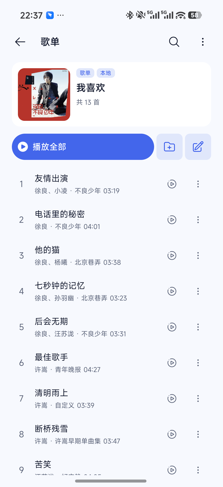

# 子页面逐项验收

状态：代码已完成，等待用户在 Android 设备上逐页验收。

本地预览包使用独立包名 `io.github.yingjiedev.audiora.preview`，桌面名称为「Audiora 预览」。正式版使用另一张签名证书，预览版与正式版并存，正式版及其数据保留。预览版需要准备插件、少量本地音乐和歌单；可以在正式版导出备份，再在预览版导入测试数据。

每项先检查布局，再检查关键操作。建议先用浅色主题逐页检查，再切换深色、自定义背景复核；最后用大字体、横屏检查长标题、按钮、筛选栏和安全区。

| 完成 | 页面与入口 | 关键验收点 |
| --- | --- | --- |
| [ ] | 我的 → 我喜欢／我的歌单 → 详情 | 封面、标题、简介展开／收起、歌曲数、播放全部、添加到歌单、搜索、排序与批量编辑 |
| [ ] | 首页／音乐库 → 在线歌单详情 | 来源名称、作者、简介、收藏／取消收藏、播放、加载失败后重试 |
| [ ] | 搜索 → 专辑 → 详情 | 导航与类型显示「专辑」，歌名和作者清楚，播放行为遵循原设置 |
| [ ] | 首页／音乐库 → 榜单详情 | 榜单类型、来源、歌曲数、当前播放高亮与歌曲定位 |
| [ ] | 搜索 → 歌手 → 详情 | 头像、名称、简介、单曲／专辑切换；滚动折叠和横屏头部 |
| [ ] | 我的 → 全部歌单 | 我的／收藏分类、数量、长歌单名、创建、导入、删除与取消收藏 |
| [ ] | 首页 → 推荐歌单 | 来源切换、标签筛选、封面网格、加载／空态／错误重试、滚动加载更多 |
| [ ] | 首页 → 榜单目录 | 分类标题、网格列数、无封面回落、失败后重试与进入详情 |
| [ ] | 首页／音乐库 → 搜索 | 输入、清除、提交、历史记录点击与删除、无插件时进入管理 |
| [ ] | 搜索 → 单曲／专辑／歌手／歌单结果 | 分类选中态、来源切换、长结果文字、封面网格、分页、错误重试、歌曲操作 |
| [ ] | 歌单／本地音乐库 → 搜索 | 显示搜索范围和结果数量；歌名、歌手、专辑、来源名称匹配；清除与无匹配提示 |
| [ ] | 音乐库 → 本地音乐管理 | 摘要、扫描入口、空列表提示、搜索、批量管理及播放 |
| [ ] | 我的 → 下载管理 | 概览数量、下载中／已完成／失败数量；暂停／继续、进度、日期分组、重试、清理记录 |
| [ ] | 歌单／本地音乐／历史 → 批量编辑 | 全选／全不选、选择数量、无选择时禁用操作、下一首、添加到歌单、下载、删除后保存、拖动排序 |
| [ ] | 本地扫描／导入 → 文件选择 | Android 打开系统选择器；选择、取消、文件夹授权；返回应用完成导入，不停留在等待页面 |
| [ ] | 我的 → 播放历史 | 数量、歌曲行、空态、播放、编辑与清空 |
| [ ] | 我的 → 听歌报告 | 7／30／90 天、统计、活跃图、无数据说明、横屏安全区 |
| [ ] | 我的 → 设置／基本设置各分类 | 分组、长当前值、开关、选择框、分类导航及大字体下控件完整显示 |
| [ ] | 设置 → 主题设置 | 显示风格、封面样式、字体、配色方案、启动图、外观微调；选中态和返回导航 |
| [ ] | 主题设置 → 自定义主题 | 背景导入／预览、模糊／透明度、各颜色选择、颜色值、完成操作；用户设置不被重置 |
| [ ] | 主题设置 → 背景调整 | 未配置背景时有说明及选择入口；已有背景可调整、重置和清除 |
| [ ] | 设置 → 插件管理 | 摘要、启用开关、插件操作、安装／更新、长名称与空态 |
| [ ] | 插件管理 → 订阅 | 添加、编辑、删除、复制地址、长地址换行与无订阅状态 |
| [ ] | 插件管理 → 排序 | 拖拽手柄、完成保存、返回后顺序保持；大字体和横屏下拖拽位置正常 |
| [ ] | 设置 → 备份与恢复 | 本地导出／导入、WebDAV 设置、长地址与当前值、错误反馈 |
| [ ] | 设置 → 权限管理 | 通知权限状态、申请授权、打开系统设置、返回后刷新状态 |
| [ ] | 设置 → 关于 | 应用标识、版本／构建时间、检查更新、公告和项目说明 |

反馈时请注明页面、主题、字体大小、操作步骤和现象；截图由用户按需提供。源码与自动测试通过不表示真机视觉验收通过。

## 最终操作设计

- 通用次级按钮的可见背景从 32dp 起，外层保持至少 44dp 点击区域；明确的底部表单主操作才使用较大尺寸和全宽布局。
- 歌单播放操作区采用小圆形播放键与“播放全部”文字，右侧提供“加入歌单”“编辑”的图标文字操作；在线歌单可收藏／取消收藏。
- 音源标签内容垂直居中；菜单列表使用内容高度，隐藏项不占用列表位置。

## 截图与验收边界

以下是真机修改前截图，用于说明旧版播放长条与图标方块的视觉比例。新版截图与最终视觉验收尚待用户完成；代码验证不能代替原生视觉验收。

## 验证记录

- 完整 Jest：116 套／890 项通过。
- 颜色测试：21 套／254 项通过。
- `npm run lint`：0 错误、102 警告。
- `npm run check:colors`、`npm run check:ui`、`npm run typecheck:runtime`、`git diff --check` 通过。
- 完整 TypeScript 相对改造前基线没有新增诊断；基线已有诊断仍存在。
- Android arm64-v8a 预览包已构建、通过 v2 签名验证并安装到物理设备，确认版本为 `0.4.0-preview.20261014.225055`（versionCode `1791989455`）。正式版与预览版并存，未清除两者数据。
- iOS 编译与原生视觉未在 Windows 上验证；Android 页面、浅色／深色／自定义主题以及长文本、窄屏、横屏仍由用户逐页验收。